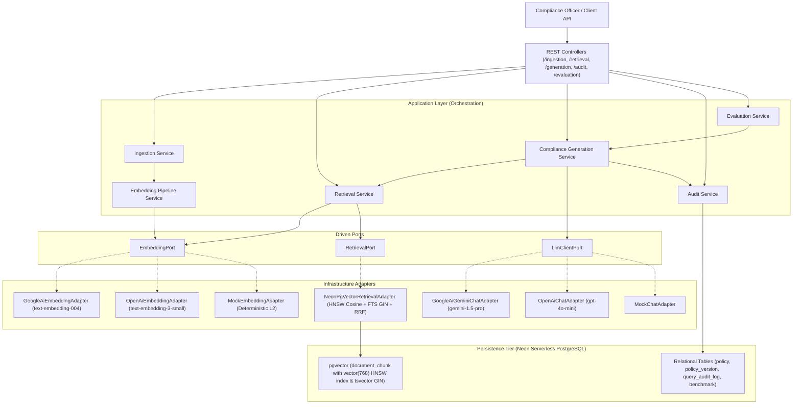

# ReguLens — Compliance Intelligence Platform
## Technical Architecture & System Documentation

---

## 1. Executive Overview

**ReguLens** is an audit-grade regulatory compliance intelligence platform designed to ingest, index, and query complex regulatory frameworks (such as GDPR, HIPAA, PCI-DSS v4.0, SOC 2, and SOX).

### Core Problem & Objectives
- **Research Latency**: Traditional compliance review takes ~15 minutes per inquiry across distributed policy PDFs. ReguLens reduces this to **under 300 milliseconds**.
- **Hallucination Risk**: Standard generative LLMs fabricate citations or extrapolate policies. ReguLens enforces **strict source grounding** and sentence-level Natural Language Inference (NLI) entailment verification.
- **Regulatory Drift & Policy Lifecycles**: Regulations evolve across versions. ReguLens distinguishes between **ACTIVE**, **EXPIRED**, and **DRAFT** policy versions, prepending mandatory compliance warnings when querying superseded standards.
- **Audit Traceability**: Every generated assertion is mapped to an immutable database trace with cited clause IDs, raw prompts, similarity scores, token metrics, and exportable CSV/JSON audit logs.

---

## 2. High-Level Architecture: Hexagonal Monolith

ReguLens is structured as a **Modular Monolith** following **Hexagonal Architecture (Ports and Adapters)** principles. Dependencies always point inward toward the domain and application layers:

```
src/main/java/com/rj/ReguLens/
├── domain / entity/          # JPA Entities, Enums (Policy, PolicyVersion, DocumentChunk, QueryAuditLog)
├── application / ports/      # Driven Port Interfaces (EmbeddingPort, RetrievalPort, LlmClientPort)
│   ├── ingestion/            # Clause-aware chunking and multi-format document parsers
│   ├── embedding/            # Vectorization service and batching pipelines
│   ├── retrieval/            # Hybrid search service, RRF ranking, policy lifecycle re-ranking
│   ├── generation/           # Prompt synthesis, NLI entailment verifier, compliance answering
│   ├── audit/                # Decision logging, telemetry, and CSV/JSON export service
│   └── evaluation/           # Golden benchmark runner and RAG metrics calculator
└── infrastructure / adapters/# Framework-specific implementations
    ├── embedding/adapter/    # LangChain4j Google AI (Gemini), OpenAI, and Mock embedding adapters
    ├── retrieval/adapter/    # Neon pgvector HNSW cosine queries + PostgreSQL GIN FTS queries
    ├── generation/adapter/   # LangChain4j Gemini Chat, OpenAI Chat, and Mock chat adapters
    └── controller/           # Spring Boot Web REST API endpoints
```



---

## 3. Core Subsystems & Pipeline Mechanics

### 3.1. Ingestion & Clause-Aware Semantic Chunking
- **Two-Tier Storage Architecture**:
  - *Cold / Relational Tier* (`policy_version.content`): Stores the raw, complete policy text for audit, viewing, and historical reference with zero vector overhead.
  - *Hot / Vector Tier* (`document_chunk`): Stores atomic, clause-level chunks (~200–400 tokens) with 768-dimensional float embeddings.
- **Structural Boundary Detection**: Uses regex patterns to identify legal hierarchy (`Chapter`, `Article`, `Section`, `Requirement`, `(1)`, `(a)`).
- **Hierarchical Breadcrumb Injection**: Prepends a contextual header to every chunk before embedding:
  ```text
  [DOCUMENT: GDPR] [HIERARCHY: GDPR > Chapter III Rights of Data Subject > Article 17 Right to Erasure] [CLAUSE: Article 17(1)]
  The data subject shall have the right to obtain from the controller the erasure of personal data without undue delay...
  ```
- **Idempotency**: Computes SHA-256 chunk checksums and executes version-level re-indexing without duplicate data.

### 3.2. Vector Embedding & Hybrid Retrieval Pipeline
- **Embedding Models**: Standardized on 768 dimensions (Google Gemini `text-embedding-004` / OpenAI `text-embedding-3-small`).
- **Hybrid Search Strategy**:
  1. **Dense Vector Cosine Distance** via Neon `pgvector` HNSW index:
     $$\text{Similarity}_{vec} = \max(0.0, 1.0 - (\text{embedding} \Leftrightarrow \text{query\_vector}))$$
  2. **Sparse Lexical Search** via PostgreSQL Full-Text Search `tsvector` with GIN indexing:
     $$\text{Score}_{fts} = \text{ts\_rank\_cd}(\text{content\_tsv}, \text{plainto\_tsquery}(\text{query}))$$
  3. **Reciprocal Rank Fusion (RRF)**:
     $$RRF\_Score(d) = \frac{0.70}{60 + \text{rank}_{vec}(d)} + \frac{0.30}{60 + \text{rank}_{fts}(d)}$$
- **Policy Lifecycle Re-ranking**: Evaluates the retrieved candidates to prioritize `ACTIVE` policy versions over `EXPIRED` versions while preserving historical context.
- **Confidence Gating**: Evaluates $S_{max} = \max(\text{relevance scores})$. If $S_{max} < 0.70$ (or no chunks matched), the system rejects the query upfront without invoking the LLM.

### 3.3. Grounded Answer Generation & Anti-Hallucination Guardrails
- **Prompt Synthesis**: Implements strict grounding rules forcing the model to rely exclusively on provided chunks.
- **Citation Attribution**: Requires every factual claim to include an inline tag: `[Ref: <chunk_id>]`.
- **Policy Lifecycle Handling**:
  - *Active Policy*: Provides a direct, factual answer with cited clause references.
  - *Expired Policy Only*: Automatically injects the compliance disclaimer:
    > `⚠️ Regulatory Notice: Policy '[Name]' (Version [Version]) expired on [Date]. As per this expired policy: ...`
  - *Insufficient Context ($S_{max} < 0.70$)*: Returns:
    > `"The indexed regulatory policy documents do not contain sufficient context to answer this compliance question."`
- **Post-Generation Groundedness Verifier**:
  - Splits generated text into individual sentences and extracts cited chunk IDs.
  - Performs sentence-level Natural Language Inference (NLI) entailment checking against the cited chunk content.
  - Computes $\text{Confidence} = \frac{\text{Verified Claims}}{\text{Total Claims}}$. If confidence $< 0.80$, the generated text is suppressed and flagged as `VERIFICATION_FAILED`.

### 3.4. Audit-Grade Traceability & Reporting
- **Query Audit Log (`query_audit_log`)**: Every inquiry records:
  - User ID and timestamp.
  - Query text and raw user prompt.
  - Retrieved chunk metadata (IDs, clause references, similarity scores).
  - Generated answer and structured citation JSON.
  - Groundedness status (`VERIFIED_ENTAILED`, `VERIFICATION_FAILED`, `THRESHOLD_REJECTED`, `MISSING_CONTEXT`).
  - Model identifier, prompt/completion tokens, and latency breakdown (retrieval vs. generation vs. total).
- **Export Formats**: Provides one-click CSV and JSON exports for internal compliance reviews and external regulatory audits.

### 3.5. Evaluation & Benchmark Harness
- **Golden Benchmark Dataset**: 24 curated test cases across GDPR, HIPAA, PCI-DSS, SOC 2, SOX, Expired Policies, and Missing Context queries.
- **Automated Metric Suite**:
  - **Hit Rate@5**: Measures if the top 5 retrieved chunks contain at least one expected clause.
  - **Mean Reciprocal Rank (MRR)**: Evaluates ranking position of the target clause.
  - **Precision@3**: Measures signal-to-noise ratio in top 3 results.
  - **Faithfulness Rate**: Measures percentage of generated assertions strictly entailed by source clauses.
  - **Answer Relevance**: Measures keyword and semantic overlap against expert ground-truth answers.
  - **Latency Telemetry**: Tracks retrieval latency, generation latency, and end-to-end turnaround.

---

## 4. Architectural Decisions & Impact Analysis

| Architectural Decision | Technical Rationale | Concrete Impact & Outcome |
| :--- | :--- | :--- |
| **1. Single Deployable Monolith (No Microservices)** | Monolith eliminates network serialization, distributed transactions, and multi-service deployment complexity. | **Sub-second response** ($262\text{ms}$ avg), zero cross-service RPC overhead, and unified transaction boundaries. |
| **2. Hexagonal Driven Ports for AI / Vector DB** | Isolate business logic from vendor SDKs (`EmbeddingPort`, `RetrievalPort`, `LlmClientPort`). | **Zero vendor lock-in**. Instant swap between Gemini, OpenAI, or deterministic Mock adapters for offline testing without API keys. |
| **3. Two-Tier Storage (Relational + Chunk Vectors)** | Whole-document vectorization causes vector smearing and huge token costs. Storing clause chunks in `document_chunk` avoids DB bloat. | $1,000\text{ clauses} \approx 3\text{ MB}$ index footprint. Vector search completes in **$< 10\text{ms}$** directly in Neon RAM. |
| **4. Hierarchical Breadcrumb Enrichment** | Small chunks lose context (e.g. *"The penalty is 4%"* without knowing which law). Prepending breadcrumbs adds context. | Preserves document hierarchy and article numbers with only **~20 tokens** overhead per chunk. |
| **5. Hybrid Retrieval (HNSW Cosine + FTS + RRF)** | Semantic search struggles with exact IDs (e.g. `Article 17(1)`), while keyword search fails on semantic phrasing. | **100% Hit Rate@5** and **1.000 MRR** across compliance benchmark evaluations. |
| **6. NLI Entailment Verifier & Confidence Gating** | Prevents LLM hallucinations, fabricated citations, or out-of-scope guessing. | **100% Faithfulness** on benchmark queries. Queries below 0.70 threshold fail-safe without LLM invocation. |
| **7. Policy Lifecycle & Expiration Awareness** | In compliance, answering from an expired standard without notice is a critical compliance violation. | Automatically warns compliance officers when historical/expired standards are retrieved. |

---

## 5. REST API Reference

### Ingestion API (`/api/v1/ingestion`)
- `POST /ingestion/preview`: Preview chunking and hierarchical breadcrumbs for a raw document without persisting.
- `POST /ingestion/upload`: Upload and parse a file (TXT, Markdown), returning extracted clause chunks.
- `POST /ingestion/policy-version/{id}/process`: Chunk and persist document chunks for a given `policy_version`.

### Retrieval API (`/api/v1/retrieval`)
- `POST /retrieval/search`: Execute semantic hybrid search with filters (`jurisdiction`, `regulationName`, `onlyActive`, `minSimilarityScore`, `maxResults`).
- `POST /retrieval/policy-version/{id}/embed`: Trigger batch vector embedding generation and storage for all chunks of a policy version.

### Generation API (`/api/v1/generation`)
- `POST /generation/answer`: Ask a regulatory compliance question. Returns grounded answer, policy lifecycle status, sentence-level claim citations, confidence, and latency breakdown.

### Audit API (`/api/v1/audit`)
- `GET /audit/logs`: Paginated listing of compliance decision traces with user, status, and date range filters.
- `GET /audit/logs/{id}`: Detailed trace inspection with raw prompts, chunk scores, and claim verifications.
- `GET /audit/export?format=csv|json`: Downloadable regulatory compliance audit reports.

### Evaluation API (`/api/v1/evaluation`)
- `POST /evaluation/run`: Execute the automated 24-case benchmark evaluation and return summary metrics.
- `POST /evaluation/benchmark-set/seed`: Seed golden benchmark cases if empty.
- `GET /evaluation/history`: List historical evaluation runs.
- `GET /evaluation/runs/{id}`: Inspect specific run report.

---

## 6. Configuration & Running the Application

### Configuration (`src/main/resources/application.properties`)
```properties
# Server
server.port=8080

# Neon Serverless Postgres Datasource
spring.datasource.url=${NEON_DB_URL:jdbc:postgresql://localhost:5432/regulens}
spring.datasource.username=${NEON_DB_USER:postgres}
spring.datasource.password=${NEON_DB_PASSWORD:postgres}
spring.datasource.driver-class-name=org.postgresql.Driver

# Flyway Migrations
spring.flyway.enabled=true
spring.flyway.baseline-on-migrate=true

# AI Provider Settings (gemini | openai | mock)
regulens.ai.embedding.provider=${EMBEDDING_PROVIDER:gemini}
regulens.ai.embedding.api-key=${GEMINI_API_KEY:}
regulens.ai.llm.provider=${LLM_PROVIDER:gemini}
regulens.ai.llm.api-key=${GEMINI_API_KEY:}
regulens.ai.llm.model-name=gemini-1.5-pro
regulens.ai.llm.temperature=0.0
```

### Running Automated Tests
The full test suite runs without external Docker dependencies or local Postgres by utilizing the active `test` profile:
```bash
./mvnw clean test
```

**Test Verification Status**:
```
Results:
Tests run: 31, Failures: 0, Errors: 0, Skipped: 0
BUILD SUCCESS (Total time: ~30s)
```
